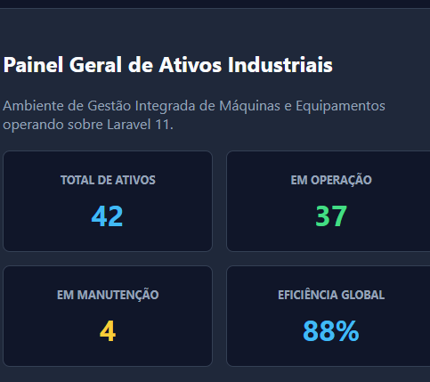
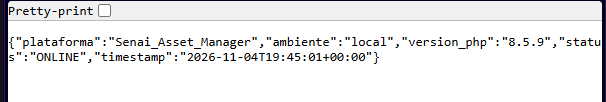
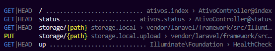
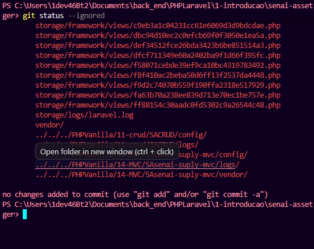
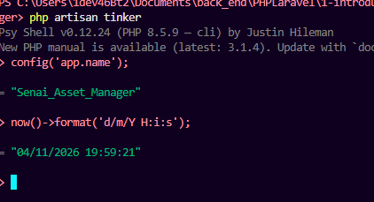

Execute a sequência de 7 testes no laboratório:

1. **Teste 1 — Listagem Geral e Inspeção das Rotas (`GET /clientes`):**  
   Acesse no navegador `http://localhost:8000/clientes`.  
   *Resultado Esperado:* A tabela renderiza os 3 clientes iniciais de teste com botões de ação RESTful.

2. **Teste 2 — Cadastro via Verbo POST e Proteção Anti-CSRF (`POST /clientes`):**  
   Clique em **+ Cadastrar Parceiro**, informe Razão Social *"Siemens Automação"*, CNPJ *"12.345.678/0001-90"*, setor *"Robótica"* e submeta.  
   *Resultado Esperado:* A requisição POST é validada com `@csrf`, redireciona para a lista exibindo a mensagem verde *"Cliente cadastrado com sucesso!"* e o novo registro #4 no rodapé da tabela.

3. **Teste 3 — Exibição de Ficha Técnica (`GET /clientes/{id}`):**  
   Clique no botão **Ficha** do cliente #4.  
   *Resultado Esperado:* A rota invoca `show(4)` e renderiza a ficha técnica detalhada.

4. **Teste 4 — Teste de Constraint com Falha Intencional (404 Automático):**  
   Tente digitar manualmente na barra de endereços do navegador: `http://localhost:8000/clientes/palavra`.  
   *Resultado Esperado:* Resposta HTTP 404 imediata. O constraint `whereNumber('cliente')` barrou a requisição antes mesmo de invocar o controller!

5. **Teste 5 — Atualização com Method Spoofing (`PUT /clientes/{id}`):**  
   Entre em **Editar**, mude a Razão Social para *"Siemens Energy & Automation"* e envie.  
   Abra o DevTools (**F12 ➔ Network/Rede**) ao enviar:  
   *Resultado Esperado:* O formulário envia um POST com payload contendo `_method: PUT` e `_token: ...`. O Laravel despacha para a ação `update()` e salva as alterações.
   

6. **Teste 6 — Exclusão Segura via Verbo DELETE (`DELETE /clientes/{id}`):**  
   Clique no botão vermelho **Excluir** do cliente #4 e confirme a caixa de diálogo.  
   *Resultado Esperado:* A requisição DELETE remove o item da sessão e recarrega a tabela sem o parceiro excluído.
   
7. **Teste 7 — Simulação de Falha de Segurança CSRF (HTTP 419):**  
   No arquivo `resources/views/clientes/create.blade.php`, comente temporariamente a linha `@csrf` e tente cadastrar um novo cliente.  
   *Resultado Esperado:* O Laravel bloqueia a requisição e exibe a tela de erro **419 | PAGE EXPIRED**, comprovando a proteção ativa do middleware `VerifyCsrfToken`!  
   *Restauração:* Descomente a diretiva `@csrf` e recarregue.